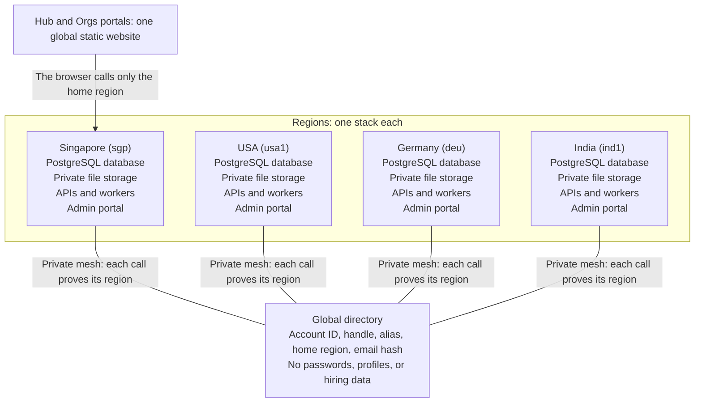

# Thoughts behind Vetchium

## About this document

This document records the decisions behind Vetchium. Each entry gives a
decision and a summary of the reasons.

- **Readers:** users, Orgs, partners, and contributors.
- **Updates:** we add an entry when we make a decision. We will share the
  document before launch.
- **Location:** `docs/` in the source repository. Coding agents read it only
  when a task names it.

## Data sovereignty

Each Hub user and each Org selects a home region at signup. Vetchium stores
their data in that region. Other regions read the data only to show it to a
signed-in viewer.

Reasons:

- Users and Orgs must know which laws apply to their data.
- One global database is one point of failure and one target for attacks.

The portals keep no user data. Each region has its own stack. The directory
keeps only the data that routing needs.

### Rules

- Each region has its own database, file storage, APIs, workers, and Admin
  portal. Regions do not share databases, buckets, keys, or networks.
- Signup recommends a region from the user's country of residence. The user
  can select a different eligible region.
- The browser sends signup data only after the user submits the form. It sends
  the data only to the selected region.
- The browser connects only to the user's home region.
- The global directory keeps the account ID, the handle, the alias, the home
  region, and the Org domains. It also keeps a keyed hash of the account
  email. Nobody can get the address back from this hash.
- The global directory does not keep passwords, email addresses, profiles,
  subscriptions, or hiring data.
- Regions connect through a private network. Each region shows a certificate
  on each call.
- Before a region sends data to another region, it makes sure that the other
  region is the viewer's home region. It sends only the fields that the viewer
  can see.
- The author's home region keeps posts, replies, comments, and quotes. Other
  regions show them and keep no copies.
- No CDN keeps post text. A removal has an effect immediately.
- The home region keeps pictures and documents in private storage. A viewer
  gets a signed link for one file. The link expires after a short time.
- Each record has one owner region. That region applies the rules for the
  record.
- An application goes to the home region of the hiring Org, because the Org
  runs the hiring process. If that region is not the applicant's home region,
  the application leaves the applicant's home region. The Org's region also
  keeps the interviews and the offers.
- A user can move to a different region. The system copies the data, verifies
  the copy, and then changes the routing in one step.
- The Admins of the author's region do takedowns of content.

### Where each type of data is

| Data | Stored in |
| --- | --- |
| Profile, settings, sign-in details | The user's home region |
| Posts, replies, comments, quotes | The author's home region |
| The list of replies on a post (no text) | The post owner's home region |
| Org account, Org users, Openings | The Org's home region |
| Applications, interviews, offers | The hiring Org's home region, which can be different from the applicant's home region |
| Pictures, logos, offer letters | Private storage in the owner's home region |
| Account ID, handle, home region, email hash | The global directory |

## Replies

Decision: a reply is part of the conversation of its post. A reply does not
give its author reach.

### Problems on other networks

Users of large social and professional networks report these problems:

- Bots and AI tools write many replies.
- Users write short, empty comments to get attention.
- Feeds show a reply without its post. This causes attacks on the author
  (pile-ons).
- The author has little control of the replies on a post.

Cause: on these networks, a reply gives its author reach. Thus users and tools
write replies to grow their audience.

### Decisions

1. The post author controls the replies. The author sets who can reply. The
   author can hide a reply and can lock the post.
2. Feeds do not show replies. A feed does not show "X replied" or "X
   commented" items.
3. The number of replies does not change the rank of a post.
4. Replies show in time order. No paid plan changes the position of a reply.
5. To start a new conversation, a user quotes the post. The quote is a post of
   that user. The quoted author can limit quotes and can detach the post from
   a quote.
6. Each reply has its own link. The Replies tab on the author's profile shows
   the reply. The author's home region keeps the reply text.
7. Tools and integrations cannot reply to a post. Exception: the post author
   mentions the tool. Rate limits apply from launch.

### Alternative that we rejected

We examined replies as separate posts. That design has these problems:

- Feeds show replies. This causes the problems above.
- One conversation goes across many regions.
- The post author cannot control replies below other replies.
